# SOC Detection Lab — Wazuh SIEM + Active Directory + Kali Attack Simulation

A home SOC lab built on top of an existing enterprise Active Directory environment. This project deploys a self-hosted Wazuh SIEM, integrates endpoint agents enhanced with Sysmon telemetry, writes custom behavioral detection rules, and validates them against real attack simulations from a Kali Linux attacker VM.

> **Built on:** [Enterprise Active Directory Lab](https://github.com/meet246/Active-Directory-Enterprise-Lab) — Wazuh was layered on top of the existing AD DS / DNS / DHCP / GPO environment documented there.

---

## Table of Contents

- [Lab Architecture](#lab-architecture)
- [Environment](#environment)
- [Phase 1 — Wazuh SIEM Deployment](#phase-1--wazuh-siem-deployment)
- [Phase 2 — Agent Deployment](#phase-2--agent-deployment)
- [Phase 3 — Sysmon Integration](#phase-3--sysmon-integration)
- [Phase 4 — Custom Detection Rules](#phase-4--custom-detection-rules)
- [Phase 5 — Attack Simulation](#phase-5--attack-simulation)
- [Key Findings](#key-findings)
- [MITRE ATT&CK Coverage](#mitre-attck-coverage)
- [Screenshots](#screenshots)

---

## Lab Architecture

```
VMware Workstation — Host-Only Network (192.168.202.0/24)
│
├── DC01 — Windows Server 2022 (192.168.157.10)
│     AD DS │ DNS │ DHCP │ Wazuh Agent + Sysmon
│
├── CLIENT01 — Windows 11 Enterprise (192.168.202.129)
│     Domain-joined │ Wazuh Agent + Sysmon │ Attack Target
│
├── Wazuh Manager — Ubuntu Server 24.04 (192.168.202.10)
│     Wazuh v4.14.7 │ Indexer │ Dashboard │ Custom Rules
│
└── Kali Linux Attacker VM (192.168.202.x)
      Impacket │ Netcat │ Attack Simulation
```

All VMs run on an isolated Host-Only VMware network with a secondary NAT adapter for internet access during setup. No attack traffic reaches the physical network.

---

## Environment

| Component | Details |
|---|---|
| Hypervisor | VMware Workstation |
| Domain | corp.local |
| Domain Controller | Windows Server 2022 — DC01 |
| Client | Windows 11 Enterprise — CLIENT01 |
| SIEM | Wazuh v4.14.7 (all-in-one: manager + indexer + dashboard) |
| SIEM OS | Ubuntu Server 24.04 LTS |
| Attacker | Kali Linux (Impacket v0.14.0) |
| Telemetry | Sysmon v15.21 + SwiftOnSecurity config |
| Network | 192.168.202.0/24 (Host-Only) |

---

## Phase 1 — Wazuh SIEM Deployment

### Ubuntu Server VM Setup

Provisioned Ubuntu Server 24.04 on a new VMware VM with:
- 4GB RAM, 2 vCPUs, 50GB thin-provisioned disk
- NAT adapter (DHCP — for install/updates)
- Host-Only adapter (static IP — for agent communication)

Configured static IP on the Host-Only interface via Netplan (`/etc/netplan/00-installer-config.yaml`):

```yaml
network:
  version: 2
  ethernets:
    ens33:
      dhcp4: true
    ens37:
      dhcp4: false
      addresses:
        - 192.168.202.10/24
```

### Wazuh All-in-One Installation

```bash
sudo apt update
curl -sO https://packages.wazuh.com/4.14/wazuh-install.sh
sudo bash ./wazuh-install.sh -a
```

The `-a` flag installs the manager, indexer, and dashboard together on a single node. The installer outputs an auto-generated admin password on completion.

Changed the default password post-install:

```bash
sudo bash /usr/share/wazuh-indexer/plugins/opensearch-security/tools/wazuh-passwords-tool.sh \
  -u admin -p 'YourNewPassword123!'
```

Dashboard accessible at: `https://192.168.202.10`


---

## Phase 2 — Agent Deployment

### Installing Agents on Domain Controller and Windows Client

Agents were deployed manually via PowerShell (run as Administrator), pointed at the Wazuh manager's static IP:

```powershell
Invoke-WebRequest -Uri https://packages.wazuh.com/4.x/windows/wazuh-agent-4.14.7-1.msi `
  -OutFile $env:tmp\wazuh-agent
msiexec.exe /i $env:tmp\wazuh-agent /q WAZUH_MANAGER='192.168.202.10'
NET START WazuhSvc
```

Repeated on both DC01 and CLIENT01. Both agents appeared as **Active** in the dashboard.

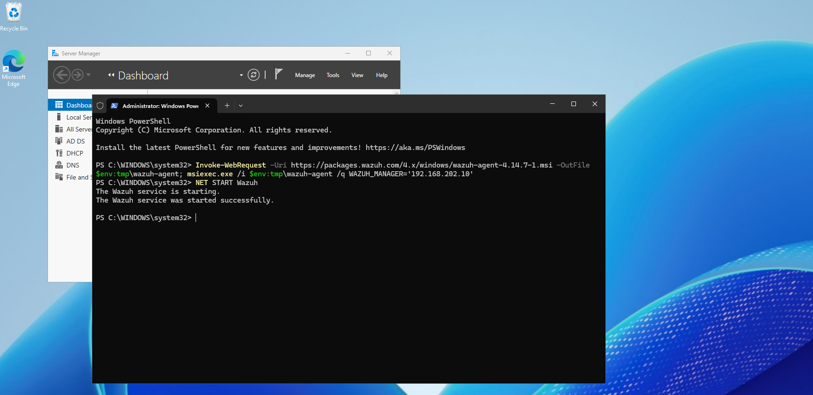
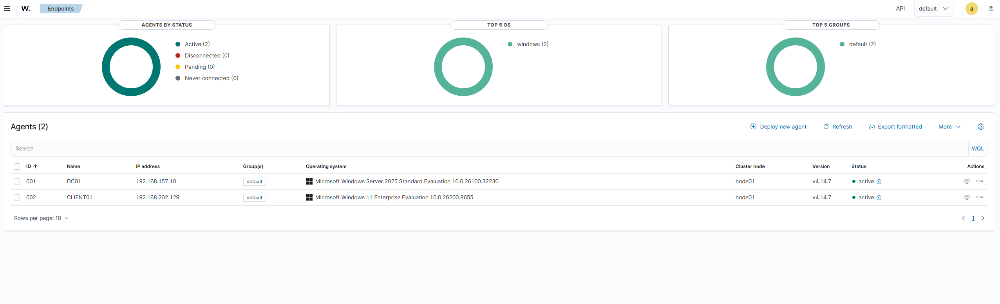

### Troubleshooting: Stale Agent Registration

After an earlier manager reinstall (required to resolve a disk-full error during initial setup), agents showed as Disconnected despite the service running. Root cause: the manager reinstall wiped the agent registration database, leaving the agents holding invalidated keys.

**Fix:** Removed the stale entry with the `manage_agents` tool on the manager, then re-ran `agent-auth.exe` on the client to generate a fresh key pair.

```bash
sudo /var/ossec/bin/manage_agents   # Remove old entry
# On client:
& "C:\Program Files (x86)\ossec-agent\agent-auth.exe" -m 192.168.202.10
```

---

## Phase 3 — Sysmon Integration

### Why Sysmon

Default Windows Event Log provides logon/logoff and account-change events, but misses process creation, network connections, and DNS queries — the telemetry most detection rules rely on. Sysmon fills this gap.

### Installation

Downloaded Sysmon v15.21 from Microsoft Sysinternals and the SwiftOnSecurity config from GitHub. Installed on both CLIENT01 and DC01:

```powershell
cd C:\Sysmon
.\sysmon64.exe -accepteula -i sysmonconfig-export.xml
```

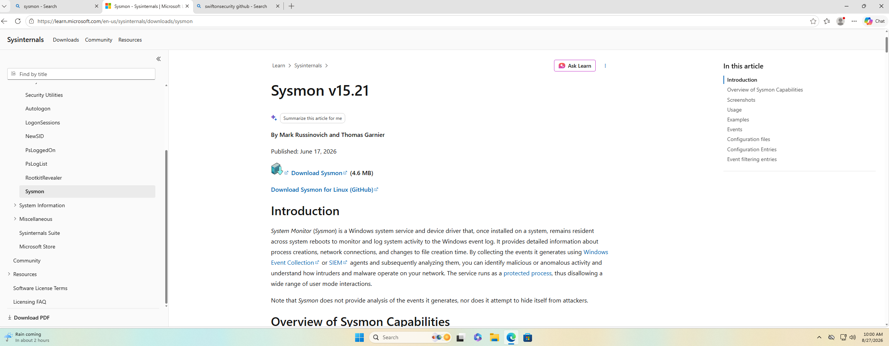
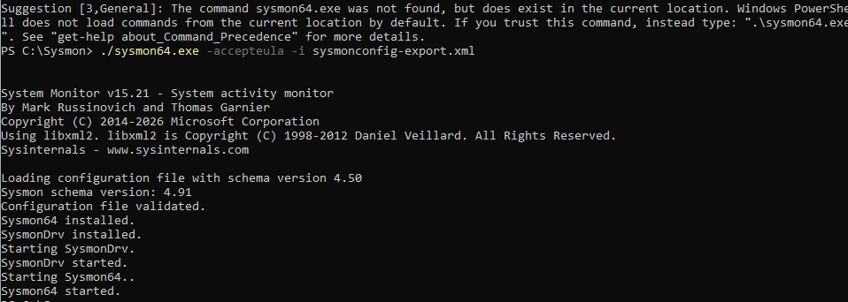

### Forwarding Sysmon Events to Wazuh

Added a `<localfile>` block to `ossec.conf` on each agent to forward the Sysmon operational channel:

```xml
<localfile>
  <location>Microsoft-Windows-Sysmon/Operational</location>
  <log_format>eventchannel</log_format>
</localfile>
```

Added after the existing `System` log block. Restarted the agent service to apply:

```powershell
Restart-Service WazuhSvc
```

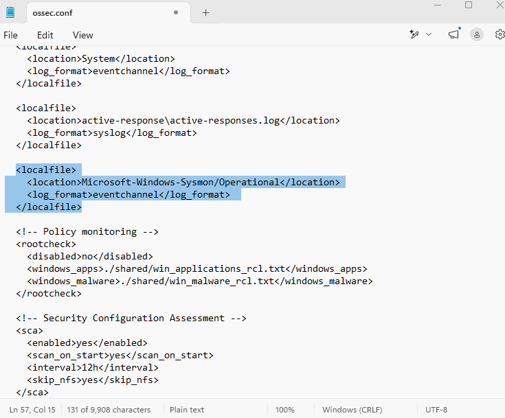

Verified Sysmon events flowing in the Wazuh dashboard by searching "sysmon" in Threat Hunting. Wazuh's built-in Sysmon ruleset (242 rules) parsed all event types immediately.

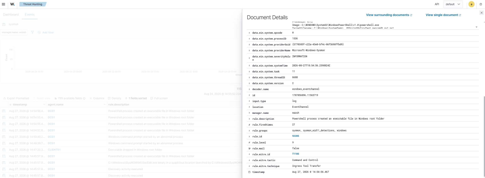
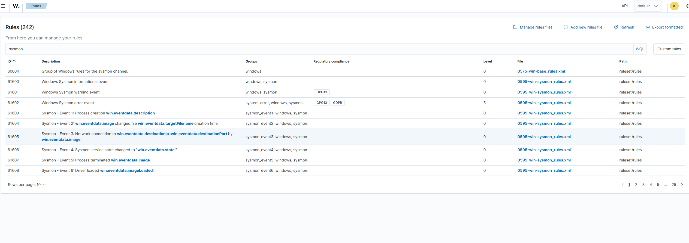

---

## Phase 4 — Custom Detection Rules

Custom rules were written in `/var/ossec/etc/rules/local_rules.xml` on the Wazuh manager. All rules were validated before applying:

```bash
sudo /var/ossec/bin/wazuh-analysisd -t
sudo systemctl restart wazuh-manager
sudo systemctl status wazuh-manager
```

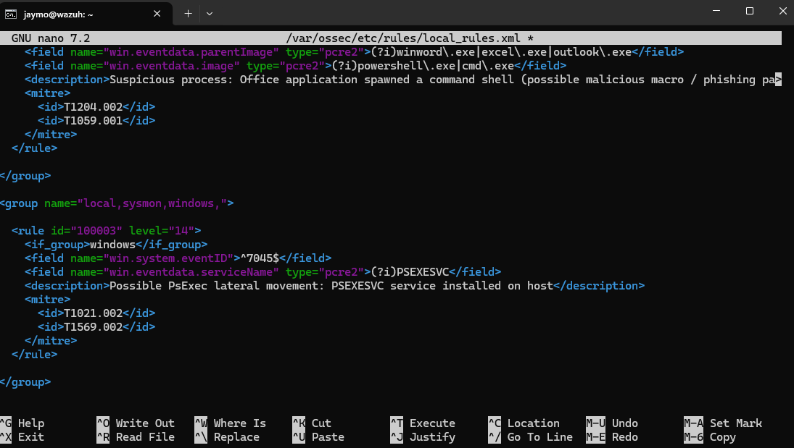

---

### Rule 100002 — Office Application Spawning a Shell

**MITRE ATT&CK:** T1204.002 (Malicious File), T1059.001 (PowerShell)
**Severity:** Level 12 (High)

**Detection logic:** Sysmon Event ID 1 (process creation) where the parent process is a Microsoft Office application and the child process is a command shell or PowerShell — the textbook phishing/malicious macro pattern.

```xml
<group name="local,sysmon,">

  <rule id="100002" level="12">
    <if_group>sysmon_event1</if_group>
    <field name="win.eventdata.parentImage" type="pcre2">
      (?i)winword\.exe|excel\.exe|outlook\.exe
    </field>
    <field name="win.eventdata.image" type="pcre2">
      (?i)powershell\.exe|cmd\.exe
    </field>
    <description>
      Suspicious process: Office application spawned a command shell
      (possible malicious macro / phishing payload)
    </description>
    <mitre>
      <id>T1204.002</id>
      <id>T1059.001</id>
    </mitre>
  </rule>

</group>
```

**Test (no Office license required):** Copied `cmd.exe` to `C:\Temp\winword.exe` (process masquerading), launched it, then typed `powershell` inside to spawn a child shell. Sysmon logged the parent as `C:\Temp\winword.exe` and child as `powershell.exe` — matching the rule's logic exactly, since Sysmon tracks the filename path, not the underlying binary identity.

This technique — simulating the correct parent-child process relationship via process renaming — is a realistic analog to how malicious Office macros actually behave, making it a valid detection test without requiring a licensed Office installation.

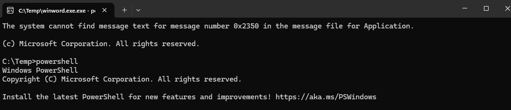
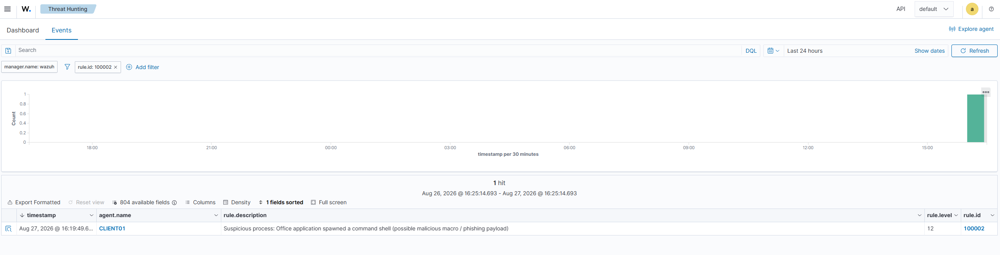

---

### Rule 100003 — PsExec-Style Lateral Movement

**MITRE ATT&CK:** T1021.002 (SMB/Windows Admin Shares), T1569.002 (Service Execution)
**Severity:** Level 14 (Critical)

**Detection logic:** Windows Event ID 7045 (new service installed) where the service binary path is directly in the Windows root directory with no subdirectory — the forced file placement pattern of PsExec-style remote execution, regardless of what the service is named.

```xml
<group name="local,sysmon,windows,">

  <rule id="100003" level="14">
    <if_group>windows</if_group>
    <field name="win.system.eventID">^7045$</field>
    <field name="win.eventdata.imagePath" type="pcre2">
      (?i)^%systemroot%\\\\[^\\\\]+\.exe$
    </field>
    <description>
      Suspicious service installed directly in Windows root
      (possible PsExec-style lateral movement via admin shares)
    </description>
    <mitre>
      <id>T1021.002</id>
      <id>T1569.002</id>
    </mitre>
  </rule>

</group>
```

**Key design decision — behavioral vs. IOC-based detection:**

The initial version of this rule matched specifically on the service name `PSEXESVC`. During the attack simulation, Impacket generated a randomized service name (`YMbR`, `GTBo`, `CZkl`) — causing the rule to miss entirely while Wazuh's default rule (92650) still fired, because the default rule matched on the *binary path pattern*, not the name.

The rule was rewritten to match the `imagePath` field against the pattern `%systemroot%\\<filename>.exe` (no subdirectory), which catches any variant of this technique regardless of the service name the attacker chooses. Legitimate Windows services essentially never install directly to the Windows root — they live in `System32`, `SysWOW64`, or application-specific subdirectories.

This rewrite is the core detection engineering lesson of this project: **an IOC-based rule can be defeated by changing one variable. A TTP-based / behavioral rule targets something the technique itself forces the attacker to do.**

---

## Phase 5 — Attack Simulation

### Lab Setup

Kali Linux was deployed on the same Host-Only network (192.168.202.0/24). A new NetworkManager connection profile was created to get the NAT adapter online:

```bash
sudo nmcli connection add type ethernet ifname eth0 con-name eth0-nat autoconnect yes ipv4.method auto
sudo nmcli connection up eth0-nat
```

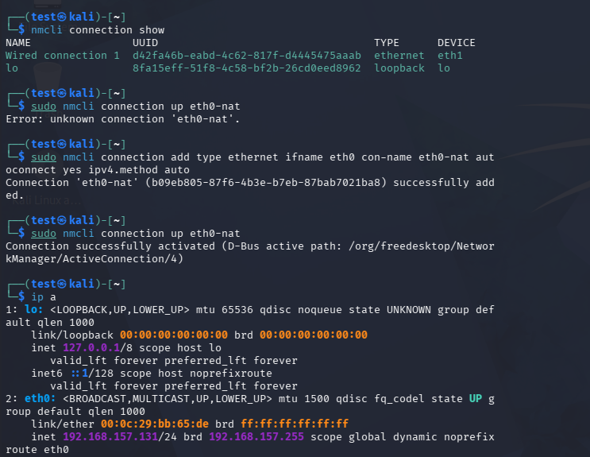

### Preparing the Target (CLIENT01)

Two prerequisites were required on CLIENT01:

**1. Enable File and Printer Sharing (SMB port 445):**
The Host-Only adapter was categorized as Public by Windows, blocking SMB. Set to Private to enable the required firewall rules:

```powershell
Set-NetConnectionProfile -InterfaceAlias "Ethernet1" -NetworkCategory Private
```

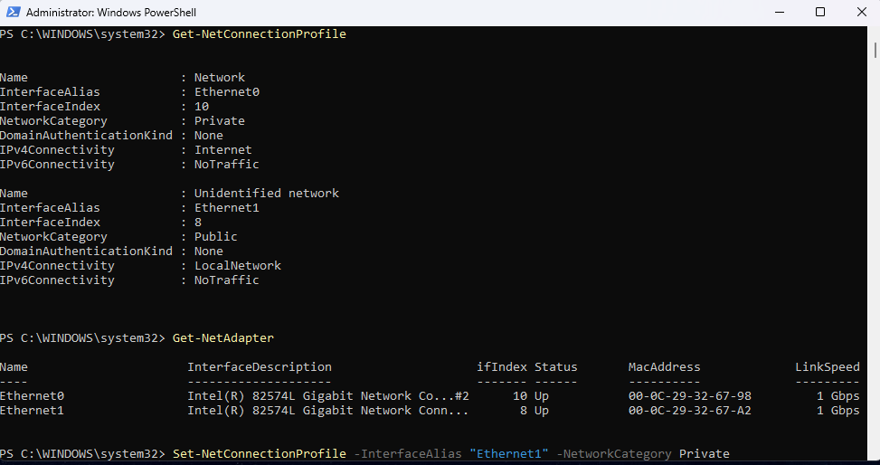

**2. Enable the built-in local Administrator account:**
Impacket's PsExec requires an account exempt from UAC Remote Restrictions. The built-in Administrator account is the standard choice:

```powershell
net user administrator /active:yes
net user administrator Admin1234!
```

### Running the Attack

From Kali, using Impacket's `impacket-psexec`:

```bash
impacket-psexec 'CLIENT01/administrator:Admin1234!@192.168.202.129'
```

First attempt (with Windows Defender enabled): Service was created and started, but Defender immediately quarantined the dropped executable (`VirTool:Win32/RemoteExec!pz`), preventing the shell from establishing. The Event ID 7045 was still written to the Windows event log before Defender intervened.

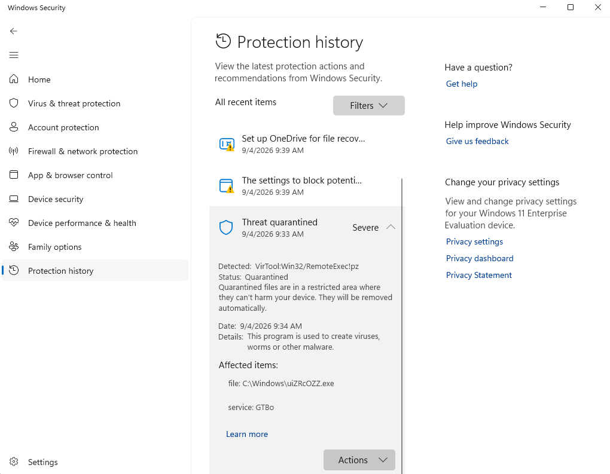
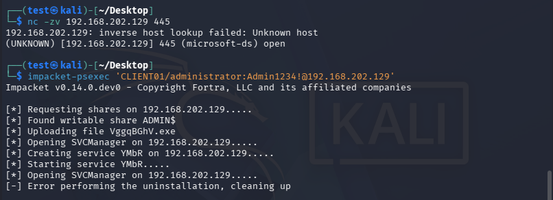

Second attempt (with Defender real-time protection temporarily disabled): Full SYSTEM shell established successfully.

```
C:\Windows\System32> whoami
nt authority\system
```

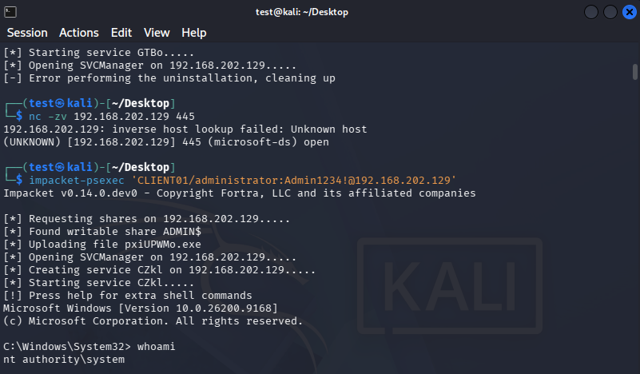

### Detections

Both Wazuh's default rule and the custom Rule 100003 fired on the attack:

| Rule | ID | Level | Source |
|---|---|---|---|
| New Windows Service Created to start from Windows root path | 92650 | 12 | Wazuh default |
| Suspicious service installed directly in Windows root (PsExec-style) | 100003 | 14 | Custom — this project |

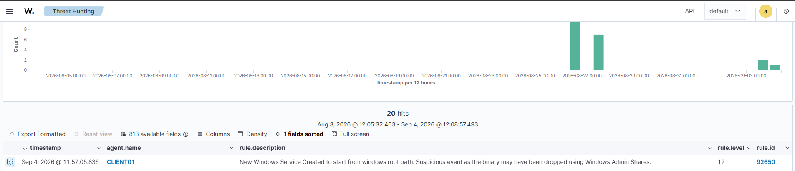
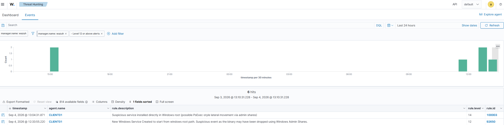
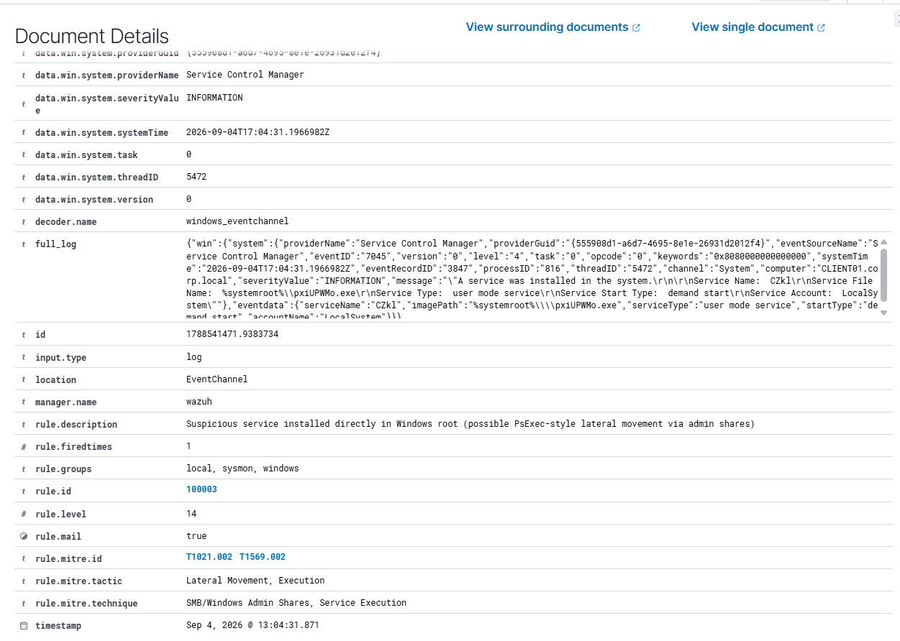

---

## Key Findings

**1. Defense-in-depth demonstrated across two independent layers**
Defender (prevention) quarantined the payload before shell execution. Wazuh (detection) captured the service installation event independently — because the Event ID 7045 entry is written to the Windows event log before the executable runs. Both layers operate independently, meaning Defender blocking the payload did not prevent Wazuh from detecting the attempt.

**2. IOC-based detection vs. TTP-based detection**
The initial Rule 100003 matched on the literal string `PSEXESVC`. Impacket randomizes the service name by default, so the rule missed all real attack runs while matching on only the textbook example. The rewritten rule matches on the binary path pattern (`%systemroot%\<name>.exe`) — something the technique forces the attacker to use regardless of what they name the service.

**3. Stock Impacket is a known signature**
Defender flagged the dropped executable as `VirTool:Win32/RemoteExec!pz` immediately. A real attacker would use a custom-compiled payload to evade static signature detection. The behavioral Wazuh detection (path-based) remains effective against both because it targets the file placement the technique requires, not the payload's binary identity.

**4. UAC Remote Restrictions as a meaningful control**
Non-built-in local admin accounts are subject to UAC Remote Restrictions and receive a filtered token for remote connections, preventing full admin access even when they are group members. This is why the attack required the built-in Administrator account — a realistic and documentable constraint worth understanding for lateral movement analysis.

**5. Network profile categorization affects firewall posture**
Windows categorized the Host-Only adapter as Public (no DC reachability verification at boot), blocking SMB inbound by default. In a real domain environment, the adapter would be DomainAuthenticated and the firewall posture managed centrally via GPO security baselines. The manual Private override in this lab stands in for what GPO would handle automatically in production.

---

## MITRE ATT&CK Coverage

| Rule ID | Technique ID | Technique Name | Tactic |
|---|---|---|---|
| 100002 | T1204.002 | User Execution: Malicious File | Execution |
| 100002 | T1059.001 | Command and Scripting Interpreter: PowerShell | Execution |
| 100003 | T1021.002 | Remote Services: SMB/Windows Admin Shares | Lateral Movement |
| 100003 | T1569.002 | System Services: Service Execution | Execution |

---

## Screenshots

| File | Description |
|---|---|
| `wazuh_login.png` | Wazuh dashboard login at 192.168.202.10 |
| `AD_wazah_setup.png` | Wazuh agent install on DC01 via PowerShell |
| `agents_management.png` | Agents Management view before enrollment |
| `agents.png` | Both DC01 and CLIENT01 active in the dashboard |
| `sysmon.png` | Sysmon v15.21 download from Microsoft Sysinternals |
| `sysmon_client_install.png` | Sysmon installation output on CLIENT01 |
| `ossec_conf.png` | Sysmon localfile block added to ossec.conf |
| `sysmon_in_SIEM.png` | Wazuh's Sysmon ruleset (242 rules) loaded |
| `sysmon_event_1.png` | Sysmon Event ID 1 (process creation) in Threat Hunting |
| `failed_logon_wazuh_events.png` | Failed logon events (4625) in Threat Hunting |
| `failed_logon_wazuh.png` | CLIENT01 agent dashboard with authentication events |
| `psexec_rule.png` | Both custom rules in local_rules.xml |
| `rule_2_test.png` | Process masquerading test — winword.exe spawning PowerShell |
| `rule_2_confirm.png` | Rule 100002 firing in Threat Hunting (1 hit, level 12) |
| `set_adapter_to_private.png` | Setting Host-Only adapter to Private for SMB access |
| `kali_dhcp_troubleshoot.png` | Kali NetworkManager DHCP fix |
| `exploit_kali.png` | Impacket-psexec attack — service created, Defender intervenes |
| `defender_threat.png` | Defender quarantine of VirTool:Win32/RemoteExec!pz |
| `kali_shell.png` | Successful SYSTEM shell via PsExec with Defender disabled |
| `wazuh_default_rule.png` | Wazuh default rule 92650 firing on service installation |
| `rule_3_confirm.png` | Both rule 100003 and 92650 firing side-by-side |
| `rule_3_details.png` | Rule 100003 full document details with MITRE ATT&CK tags |

---

## Tools & References

- [Wazuh Documentation](https://documentation.wazuh.com/)
- [SwiftOnSecurity Sysmon Config](https://github.com/SwiftOnSecurity/sysmon-config)
- [Microsoft Sysinternals Sysmon](https://learn.microsoft.com/sysinternals/downloads/sysmon)
- [Impacket — Fortra](https://github.com/fortra/impacket)
- [MITRE ATT&CK Framework](https://attack.mitre.org/)
- [Sigma Rules Repository](https://github.com/SigmaHQ/sigma)

---

## Author

**Jack Hessefort**
USF Bellini College of Artificial Intelligence, Cybersecurity and Computing — B.S. Cybersecurity (May 2026, Summa Cum Laude)
CompTIA Security+ | AWS Cloud Practitioner | CompTIA A+

[LinkedIn](https://linkedin.com/in/jackhessefort) | [GitHub](https://github.com/meet246)
